<picture>
  <source media="(prefers-color-scheme: dark)" srcset="https://raw.githubusercontent.com/git-antonio-pinheiro/git-antonio-pinheiro/main/assets/banner-dark.svg">
  
</picture>

### Sobre mim

Estudo desenvolvimento desde 2023 e hoje concentro meus estudos em **inteligência artificial** e **cibersegurança**. Gosto de entender como as coisas funcionam por dentro: rodar modelos de visão computacional em máquinas comuns, sem placa de vídeo, e reproduzir ataques em laboratório para aprender a me defender deles.

---

### 01 · Inteligência Artificial

- Detecção e rastreamento de pessoas e veículos com **YOLO** e **PyTorch**, rodando só em CPU
- Segmentação de imagens com **SAM 2.1** e inferência com **ONNX Runtime**
- APIs de inferência com **FastAPI** e processamento de imagem com **OpenCV**

`Python` `YOLO` `PyTorch` `ONNX Runtime` `OpenCV` `FastAPI`

### 02 · Cybersecurity

- **Bootcamp de Cibersegurança da DIO**, com desafios práticos de ataque e defesa
- **Engenharia social:** simulação de phishing com o Social-Engineer Toolkit no Parrot Security, em laboratório controlado
- **Criptografia:** ransomware de estudo em Python com AES, para entender como os arquivos são cifrados e recuperados
- **Trilhas de estudo:** roadmaps de cibersegurança, do zero ao avançado

`Parrot Security` `Social-Engineer Toolkit` `Python` `AES` `Engenharia social`

### 03 · Linux

- Parrot Security como ambiente dos laboratórios de segurança
- Aplicativos Python empacotados para Linux em AppImage, compatíveis com X11 e Wayland
- Terminal, Bash e contêineres Docker

`Parrot Security` `Bash` `Docker` `AppImage`

### 04 · Java

- APIs REST com **Spring Boot**: CRUD com validação, autenticação e autorização
- Consumo de APIs externas e persistência com **PostgreSQL**
- Trilha Java do **Oracle Next Education** (Alura)

`Java` `Spring Boot` `PostgreSQL` `Maven` `IntelliJ IDEA`

---

### Ferramentas

<picture>
  <source media="(prefers-color-scheme: dark)" srcset="https://skillicons.dev/icons?i=python,pytorch,opencv,fastapi,linux,bash,docker,java,spring,postgres,maven,idea,git,github,vscode&perline=8&theme=dark">
  
</picture>

### Formação

- **Udemy:** Python 3 completo, do básico ao avançado
- **DIO:** Bootcamp de Cibersegurança
- **DIO:** Bootcamp Java com Spring Boot
- **Oracle Next Education (ONE)** · Alura: trilha Java

### Contato

<a href="https://www.linkedin.com/in/antoniogabrielpnhr/">
  <picture>
    <source media="(prefers-color-scheme: dark)" srcset="https://skillicons.dev/icons?i=linkedin&theme=dark">
    
  </picture>
</a>
<a href="mailto:antonio.pinheiro2308@gmail.com">
  <picture>
    <source media="(prefers-color-scheme: dark)" srcset="https://skillicons.dev/icons?i=gmail&theme=dark">
    
  </picture>
</a>

[linkedin.com/in/antoniogabrielpnhr](https://www.linkedin.com/in/antoniogabrielpnhr/) · [antonio.pinheiro2308@gmail.com](mailto:antonio.pinheiro2308@gmail.com)
